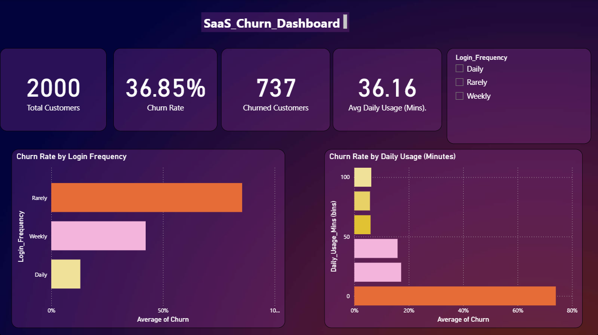
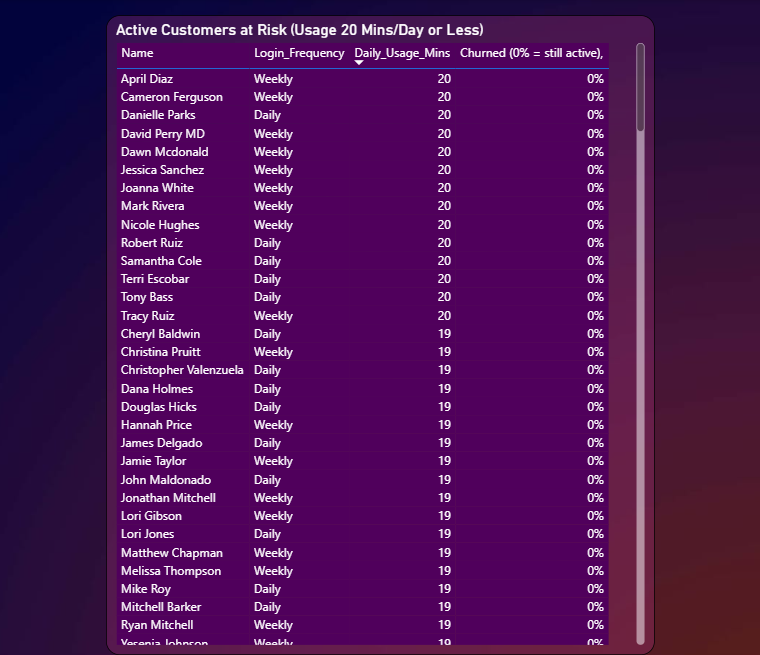

# SaaS Customer Churn Analysis

**Tools:** MySQL | Excel | Power BI &nbsp;&nbsp;|&nbsp;&nbsp; **Data:** 2,000 customers (public Kaggle dataset)

Why do SaaS customers cancel, and which behaviours warn that a customer is about to leave? This project answers that question three times, in three tools. SQL finds the patterns, Excel confirms them independently with pivot tables, and Power BI turns them into an interactive dashboard and an at-risk customer list.

## Key Findings

- **Overall churn rate: 36.85%** (737 of 2,000 customers).
- **Login frequency is the strongest signal.** Customers who rarely log in churn at **85.46%**, weekly users at 42.26%, and daily users at 13.02%.
- **Low usage is a clear danger zone.** Customers using the product 20 minutes a day or less churn at about 73% (SQL), compared with about 10% for customers using it 50+ minutes. Finer Excel buckets show churn dropping sharply after the 20-minute mark and then staying low.
- **Customers who rarely log in are all low-usage customers.** The two signals overlap heavily, but each still matters on its own.
- **Account age (548 vs 568 days) and support-ticket length (51 vs 42 characters) are weak predictors** of churn.

## Dashboard (Power BI)

**Overview page:** KPI cards (total customers, churn rate, churned customers, average daily usage), churn rate by login frequency, churn rate by daily usage bucket, and a login-frequency slicer that filters every visual.

**At-risk page:** a list of customers who are still active but use the product 20 minutes a day or less, sorted by usage. These are the customers a retention team could contact before they leave.

## What's in this repository

| File | What it contains |
|---|---|
| `churn_analysis_queries.sql` | Database setup, the data-type fix, and 8 documented SQL analyses |
| `customer_churn_analysis.xlsx` | Pivot tables, charts, a cross-tab, an XLOOKUP customer lookup, and a Summary sheet |
| `Churn_Project_Dashboard.pbix` | 2-page Power BI dashboard (open with Power BI Desktop) |
| `customers_full_export.csv` | The 2,000-row table exported from MySQL |
| `dashboard_overview.png`, `at_risk_customers.png` | Dashboard screenshots used in this README |

---

## Dataset

- Source: Kaggle, "SaaS Customer Churn Prediction Dataset" (by suhanigupta04), file `train.csv`
- Records: 2,000 customers
- Columns: Customer_ID, Name, Email, Account_Age_Days, Login_Frequency, Daily_Usage_Mins, Last_Support_Ticket, Churn
- Names and emails are placeholder-style (example.com), so this is best treated as a practice dataset, not data from a real company.

## Data Cleaning and Setup

Checks done in Excel before loading into SQL:
1. Row count confirmed: 2,000 records
2. Blank values checked (Go To Special > Blanks): none found
3. Duplicates checked on Customer_ID: none found

Setup notes (MySQL):
- Created the database `saas_churn_project` and a `customers` table matching the CSV columns.
- Bug found: Customer_ID is a UUID (36-character text, e.g. a8b2ac22-dd31-483e-8672-592b7089138f), not a whole number. The original INT column could not hold it and broke the import. Fixed with ALTER TABLE, changing the column to VARCHAR(36). All 2,000 rows then imported successfully.

## Detailed SQL Findings

Each query is documented in `churn_analysis_queries.sql` with a question, why it matters, result and insight.

1. **Overall churn rate:** 737 of 2,000 churned (36.85%).
2. **Usage minutes vs churn:** churned customers average 16.42 mins/day, retained customers 47.68 mins/day (about 3x more). This is a correlation, not proven causation.
3. **Login frequency vs churn rate:** Rarely 85.46%, Weekly 42.26%, Daily 13.02%.
4. **Account age vs churn:** churned customers average 548 days, retained customers 568 days. A small gap, so account age is a weak predictor.
5. **Usage buckets vs churn rate (CASE statement):**
   - Low (0-20 mins/day): 72.97% churn (788 customers)
   - Medium (21-50 mins/day): 16.22% churn (629 customers)
   - High (50+ mins/day): 10.29% churn (583 customers)
6. **Customers ranked by usage (RANK window function + subquery):** 48 customers tie for the worst rank at 1 min/day. A subquery was needed because window function results cannot be filtered directly with WHERE.
7. **Support ticket length vs churn (LENGTH):** churned customers average 50.89 characters, retained customers 41.92. A small difference and a weak predictor.
8. **Login groups above 50% churn (HAVING):** only "Rarely" crosses the threshold (288 of 337, 85.46%).

## Detailed Excel Findings

Built independently from the raw export (`customers_full_export` sheet), not copied from SQL.

1. **Usage buckets vs churn rate** (sheet `Usage_Buckets_Chart` holds the clean pivot table and chart; a second usage-bucket sheet holds the detailed table with raw counts):

   | Daily usage (mins) | Churn rate | Customers |
   |---|---|---|
   | 0-19 | 74.02% | 766 |
   | 20-39 | 17.22% | 395 |
   | 40-59 | 15.90% | 522 |
   | 60-79 | 5.98% | 117 |
   | 80-99 | 5.77% | 104 |
   | 100-120 | 6.25% | 96 |

   Churn risk drops sharply after the 20-minute mark, then stays low. The real danger zone is 0-20 minutes a day.

2. **Login frequency vs churn rate** (sheet `Login_Freq`): Daily 13.02% (868 customers), Weekly 42.26% (795), Rarely 85.46% (337). Matches the SQL result.

3. **Login frequency x usage cross-tab** (sheet `Cross_Tab`): in the 0-19 minute band, churn rises from Daily 28.8% to Weekly 70.8% to Rarely 85.5%. Every "Rarely" customer is in this low-usage band, so the two risk factors overlap heavily, and both still carry their own signal. Cell-level customer counts are not shown, so small cells should be read with caution.

4. **Customer lookup tool** (sheet `Customer_Lookup`): enter a customer ID and one XLOOKUP formula returns that customer's full record. The sheet shows 23 sample customers as a demo, and it works for any of the 2,000.

The `Summary` sheet gives the findings in plain English.

## Reconciling SQL and Excel

The two tools report slightly different churn rates for the lowest-usage customers (SQL 72.97%, Excel 74.02%), and the difference comes from bucket boundaries, not an error:

| | Customers | Churned | Churn rate |
|---|---|---|---|
| SQL "Low" bucket (20 minutes or less) | 788 | 575 | 72.97% |
| Excel first bucket (0-19 minutes) | 766 | 567 | 74.02% |
| Difference (exactly 20 minutes) | 22 | 8 | 36% |

The 22 customers who use the product for exactly 20 minutes are counted as "low" in SQL, but fall into the 20-39 bucket in Excel. The overall churn rate (36.85%) is the same in every tool.

## Limitations

- No revenue, payment or satisfaction data, so the analysis covers behavioural churn signals (usage, login frequency, support activity), not financial impact.
- No signup or cancellation dates, so cohort or time-based analysis is not possible.
- Findings show correlation, not proven causation. For example, low usage could lead to churn, or customers who have already decided to leave may use the product less first.

## Techniques Used

- **SQL:** SELECT, WHERE, GROUP BY, aggregates (COUNT, SUM, AVG), CASE statements, window functions (RANK), subqueries, string functions (LENGTH), HAVING
- **Excel:** pivot tables, grouping, calculated fields, cross-tab, PivotCharts, XLOOKUP, absolute references
- **Power BI:** KPI cards, bar charts, binning, slicer, filtered table, custom formatting
